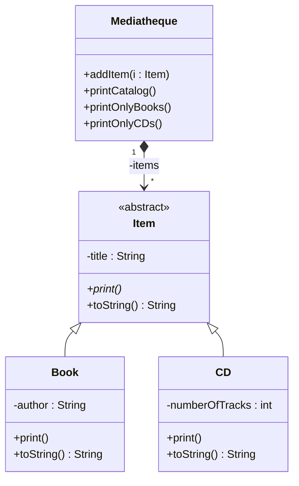

# Médiathèque — TP patron Visitor
 
*FISE4 · Patrons de conception · ISIS*
 
Code de départ du TP : le modèle simplifié d'une médiathèque, qui contient des items (`Item`), livres (`Book`) ou CD (`CD`). Les consignes sont sur Moodle ; ce fichier explique comment mettre le projet en route, travailler et rendre.
 
## Prérequis
 
| Outil | Vérification | Remarque |
|---|---|---|
| JDK 17 ou plus récent | `java -version` | le projet cible Java 17 |
| Git | `git --version` | |
| Compte GitHub | | connecté à votre IDE pour pousser |
| Maven | `mvn -v` | seulement pour lancer en terminal : IntelliJ l'intègre, et VS Code lance `Main` sans lui |
 
## 1. Créer votre dépôt
 
1. En haut de cette page : **Use this template** › **Create a new repository**.
2. Choisissez la visibilité **Public** : elle est demandée pour le rendu.
3. Clonez **votre** dépôt, pas celui-ci :
```bash
git clone https://github.com/<votre-login>/<votre-depot>.git
cd <votre-depot>
```
 
Depuis l'IDE : commande *Git: Clone* dans VS Code, *Get from VCS* dans IntelliJ.
 
## 2. Ouvrir et lancer le projet
 
**VS Code**
- Installez l'extension **Extension Pack for Java** (Microsoft).
- *File › Open Folder* sur le dossier du dépôt : le projet Maven est importé automatiquement.
- Dans `Main.java`, cliquez sur **Run** au-dessus de `main`.
- Mauvaise version de Java ? Palette de commandes › *Java: Configure Java Runtime*.
**IntelliJ IDEA** (l'édition Community suffit)
- *Get from VCS*, ou *File › Open* sur `pom.xml` › *Open as Project*.
- *File › Project Structure › SDK* : 17 ou plus récent (téléchargeable depuis cette fenêtre).
- Cliquez sur la flèche verte dans la marge de `main`, dans `Main.java`.
**Terminal**, à la racine du dépôt :
 
```bash
mvn compile exec:java
```
 
Avec le code de départ, le programme affiche :
 
```
Livre : Le seigneur des anneaux de J.R.R. Tolkien
Livre : Le Maître du haut chateau de Philip K. Dick
CD : Sergeant Peppers (12 titres)
```
 
`printOnlyBooks()` et `printOnlyCDs()` lèvent `UnsupportedOperationException` : elles ne sont pas encore implémentées, c'est l'objet du TP.
 
## Organisation du projet
 
```
src/main/java/mediatheque/
├── Main.java          point d'entrée : remplit la médiathèque et l'affiche
├── Mediatheque.java   la collection d'items
├── Item.java          classe abstraite : un titre
├── Book.java          un livre : un auteur
└── CD.java            un CD : un nombre de titres
MediathequeInitial.mdzip   diagramme de classes de départ (MagicDraw)
pom.xml                    configuration Maven (Java 17)
```
 
## Diagramme de départ
 

 
Ce diagramme suit le code. GitHub l'affiche directement ; pour le prévisualiser dans l'IDE : extension *Markdown Preview Mermaid Support* dans VS Code, option Mermaid des réglages Markdown dans IntelliJ.
 
## 3. Travailler
 
Faites un commit à chaque étape franchie, et poussez-le tout de suite :
 
```bash
git add -A
git commit -m "Visitor : interface et méthodes accept()"
git push
```
 
Depuis l'IDE : panneau *Source Control* dans VS Code ; *Commit* (Ctrl+K) puis *Push* (Ctrl+Maj+K) dans IntelliJ.
 
Règles du TP :
- ni `instanceof`, ni `ClassCastException` : le patron Visitor doit les rendre inutiles ;
- l'IA générative est fortement déconseillée pendant les TP.
## 4. Avant de rendre
 
- [ ] Le programme compile et affiche les trois éditions : catalogue complet, livres seuls, CD seuls (`mvn compile exec:java`).
- [ ] Cette commande n'affiche rien :
```bash
  git grep -nE "instanceof|ClassCastException" -- src
```
- [ ] Votre diagramme UML avec le patron Visitor est dans le dépôt : fichier MagicDraw (`.mdzip`) accompagné d'une image exportée (`.png`), ou diagramme Mermaid dans ce README.
- [ ] Tout est poussé : la page GitHub de votre dépôt affiche votre dernier commit.
 
